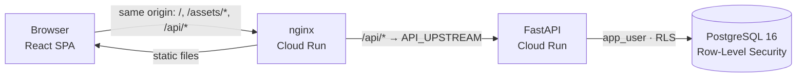

# pos-demo-react

[](https://github.com/raullucena-dev/pos-demo-react/actions/workflows/ci.yml)


[](LICENSE)

A point-of-sale and back-office UI for the multi-tenant API
[**fastapi-multitenant-rls**](https://github.com/raullucena-dev/fastapi-multitenant-rls).
Two fictitious stores share one database, isolated by the application and by PostgreSQL
Row-Level Security. Logging into one store never shows the other's data.

## Live demo

> **Live demo:** <https://pos-web-281796293339.us-east1.run.app>
>
> Two fictitious stores, **Demo Store North** and **Demo Store South**. The login page
> lists the demo users (for example `north.cashier` or `south.manager`); the password
> for all of them is `demo1234`. Logging into one store never shows the other's data.
> All data is fictitious and is reset periodically. The services scale to zero, so the
> first load may take a few seconds.
>
> The UI is served by nginx on Cloud Run and proxies `/api` to the
> [API](https://github.com/raullucena-dev/fastapi-multitenant-rls) on the same origin.
> How it is deployed: [docs/deploy.md](docs/deploy.md).

## Screenshots

> _Screenshots will be added with the live demo: login with demo credentials, the POS
> cart, and the sales report in dark mode._

## Features

- **Login.** Shows the demo credentials from `GET /demo/info` when the API runs in demo
  mode. Uses a cookie-based session. Any 401 clears all cached data and returns to the
  login page with a "session expired" message. Lockouts (423) and rate limits (429) get
  clear messages.
- **Role-aware navigation** (admin / manager / cashier) that mirrors the API's role
  checks. Forbidden routes show an "access restricted" page, and 403s from the API are
  still handled gracefully.
- **POS.** Product search and grid, a cart with quantity limits based on stock, totals
  in guaraníes (`Gs. 18.500`, no decimals) and checkout.
  - Stock updates optimistically at checkout and rolls back if the sale fails.
  - Insufficient stock is explained per product, and the cart is trimmed to what is
    available.
  - On mobile, a sticky bar keeps the total in reach.
- **Products.** List, search and paginate; create and edit with validation. Deleting
  reports whether the product was removed or archived because it has history.
- **Stock.** The movements ledger, recording purchases and adjustments, and reversals
  (compensating entries; nothing is deleted).
- **Sales report.** A date range, totals, a dependency-free accessible SVG chart, top
  products, and CSV export (UTF-8 with BOM, protected against formula injection).
- **Audit log** for admins, with usernames and an entity filter.
- **"Cómo funciona"** page explaining tenant isolation, with links to both repos.
- **Light/dark theme** via CSS variables (no flash on load). Accessible components
  (labels, focus rings, a focus-trapping dialog, `aria-live` toasts, skip link).
  Responsive down to 360px, which is checked in e2e.

UI copy is in Spanish; code, comments and docs are in English.

## Architecture



| Layer        | Choice                                                                                       |
| ------------ | -------------------------------------------------------------------------------------------- |
| Build        | Vite, React 19, TypeScript strict (`noUncheckedIndexedAccess`, `exactOptionalPropertyTypes`) |
| Routing      | React Router; back-office screens lazy-loaded                                                |
| Server state | TanStack Query with central query keys and global 401 handling                               |
| Validation   | zod for every API response and every form (react-hook-form)                                  |
| Styling      | Tailwind CSS v4 with semantic design tokens as CSS variables                                 |
| Testing      | Vitest + Testing Library + MSW; Playwright e2e against the MSW-mocked build                  |
| Serving      | nginx (unprivileged) with a same-origin `/api` proxy, strict CSP, caching, SPA fallback      |

## Design decisions

| Decision                                           | Why                                                                           | ADR                                                        |
| -------------------------------------------------- | ----------------------------------------------------------------------------- | ---------------------------------------------------------- |
| Same-origin reverse proxy instead of CORS          | First-party `HttpOnly` cookie, `SameSite=Lax`, no allow-lists                 | [0001](docs/adr/0001-same-origin-proxy-instead-of-cors.md) |
| TanStack Query for server state                    | Consistent caching and invalidation; cache wiped on 401 and logout            | [0002](docs/adr/0002-tanstack-query-for-server-state.md)   |
| zod validation of API responses                    | Contract drift fails at the boundary; money converted once to whole guaraníes | [0003](docs/adr/0003-validate-api-responses-with-zod.md)   |
| Mock backend in MSW that follows the real contract | The same handlers serve unit, integration and e2e tests, plus an offline demo |                                                            |
| No chart library                                   | A small accessible SVG chart (with a table fallback) keeps the bundle lean    |                                                            |

## Run locally

Requirements: Node 22 and pnpm (`corepack enable`).

```bash
pnpm install
pnpm dev:mock          # no backend needed: MSW plays the API in the browser
```

Against the real API, start it first from
[fastapi-multitenant-rls](https://github.com/raullucena-dev/fastapi-multitenant-rls):

```bash
# in fastapi-multitenant-rls
make up && make reset-demo     # API on :8000, demo stores loaded (password: demo1234)
# here
pnpm dev                       # http://localhost:5173, /api proxied to :8000
```

Set `API_UPSTREAM` to point the dev proxy elsewhere. Deployment to Cloud Run is described
in [docs/deploy.md](docs/deploy.md).

## Quality

| Command              | What it runs                                                                                                       |
| -------------------- | ------------------------------------------------------------------------------------------------------------------ |
| `pnpm lint`          | ESLint (typescript-eslint strict, react-hooks, jsx-a11y)                                                           |
| `pnpm typecheck`     | `tsc -b` in strict mode                                                                                            |
| `pnpm test:coverage` | 111 unit and integration tests; coverage gate 80% (currently ~97% lines)                                           |
| `pnpm e2e`           | Playwright on desktop Chrome and a 360px mobile viewport: login → sell → report, role gating, no horizontal scroll |
| `pnpm build`         | Production build. CI checks that no mock code is bundled                                                           |

CI (GitHub Actions) runs lint, typecheck, tests with coverage, the build, a Docker job
that boots the nginx image and checks headers, caching, gzip, SPA fallback and the
`/api` proxy, and the Playwright suite.

The tests cover the auth flow, 401 handling, role gating and 403s, cart maths, PYG
formatting, form validation, API error mapping (409/422/423/429/5xx, network errors,
malformed payloads) and tenant isolation.

## Project structure

```
src/
  api/          fetch client, error mapping, zod schemas, endpoints and query keys
  auth/         session provider (global 401 handling), route guards, role permissions
  components/   layout, theme toggle, UI kit (button, fields, dialog, toasts, tables)
  features/     login, pos (cart reducer), products, stock, reports (SVG chart, CSV), audit, about
  lib/          money (PYG), dates (America/Asuncion), CSV, query client
  mocks/        MSW handlers and an in-memory backend that follows the API contract
  test/         test setup and render helper
e2e/            Playwright specs
nginx/          nginx template (envsubst) and security headers
docs/           ADRs and deployment guide
```

## License

[MIT](LICENSE)

---

## Resumen en español

**pos-demo-react** es la interfaz de punto de venta y back-office para la API multi-tenant
[fastapi-multitenant-rls](https://github.com/raullucena-dev/fastapi-multitenant-rls). Está
hecha con React 19, TypeScript estricto, TanStack Query, zod y Tailwind. Incluye:

- Login con credenciales de demo y manejo global de sesión expirada (401).
- Navegación según el rol.
- Caja con carrito, totales en guaraníes y actualización optimista del stock.
- Productos, movimientos de stock con reversión, reporte de ventas con gráfico y
  exportación CSV, y auditoría.

Se sirve desde nginx en el mismo origen que la API (sin CORS) y con cabeceras de
seguridad estrictas. Tiene 111 tests con MSW y pruebas e2e con Playwright, y corre sin
backend con `pnpm dev:mock`.
